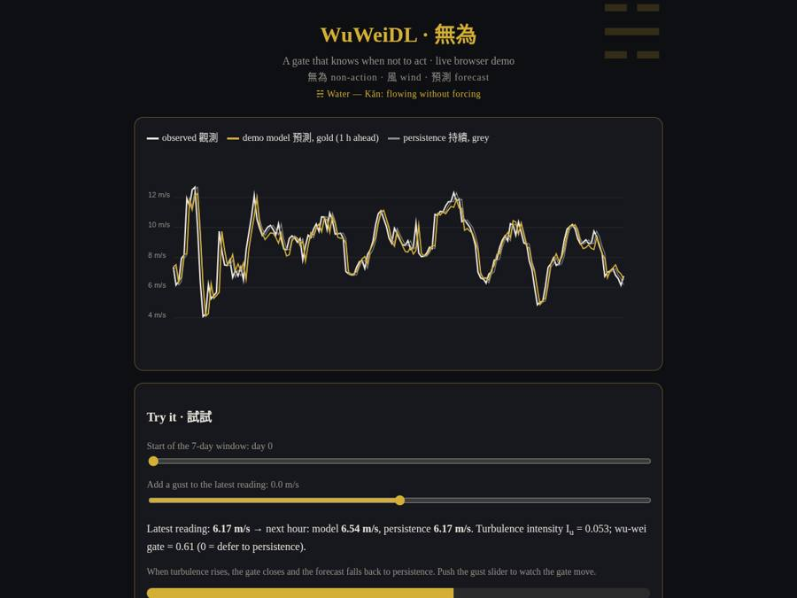

<p align="center"></p>

# WuWeiDL: Daoist-inspired Wu Wei gating and Feng-Qi turbulence encoding for wind speed forecasting (Reference Implementation)

[](https://rishabh-bgp.github.io/wuweidl-daoist-gated-wind-forecasting/) [](https://github.com/Rishabh-bgp/wuweidl-daoist-gated-wind-forecasting/actions/workflows/ci.yml) [](https://colab.research.google.com/github/Rishabh-bgp/wuweidl-daoist-gated-wind-forecasting/blob/main/notebooks/walkthrough.ipynb) [](LICENSE)  

> **Reference implementation.** This is the reference implementation of my paper (Er. Rishabh Aryan and Manimozhi I), rebuilt in Python on synthetic data because the original data is confidential. Results will differ from the published numbers.

**Keywords:** attention mechanism, daoism, deep learning, gated attention, LSTM, PyTorch, renewable energy, temporal CNN, time series forecasting, turbulence, wind energy, wind forecasting

## Paper · 論文

Er. Rishabh Aryan and Manimozhi I (2026). "Riding the Wind Like Liezi: Re-Embodying Daoist Wu Wei and Feng-Qi Dynamics in Hybrid Deep Learning Models for Ultra-Accurate Wind Speed Forecasting." *Multidisciplinary Journal of Academic Publications*.

Related registered work: Er. Rishabh Aryan (2026). "Embodying Wu Wei and Ziran in Comptemporary Practice: Daoist Philosophical Principles Applied to a Hybrid CNN-BiLSTM-Attention Model for Spatiotemporal Wind Speed Forecasting-Insights from Indian SCADA Data, Chennai ARIMA/SARIMA Analysis, and African …" Government of India (Copyright Office), LD-34737/2026-CO.

## Method · 方法

**WuWeiDL** is the reference implementation of my paper on a **turbulence-aware deep learning method for wind speed forecasting**: a Feng-Qi harmonic encoding of turbulence proxies drives a Wu Wei gate that turns attention down in turbulent conditions, blended with a temporal CNN and an LSTM. The paper proposes that a forecaster should "act less" when the wind is chaotic: a learned gate scales multi-head attention by turbulence intensity, trained with a regime-classification auxiliary loss and a gate-sparsity penalty. A related patent draft gates in the opposite direction; both are implemented (`--gate_mode patent`).

## Architecture · 架構

- **Feng-Qi Turbulence Encoder (FQTE):** 32 learnable harmonic bases ψ_k(φ)=cos(ω_k·φ+b_k) → 2-layer MLP with BatchNorm → 64-d embedding. An auxiliary regime classifier (calm, moderate, active, storm, with Iu thresholds 0.08, 0.15 and 0.25) is trained with cross-entropy at λ_aux = 0.1.
- **Temporal CNN:** residual dilated 1-D convolutions (kernel 3, dilations 1, 2, 4 and 8).
- **Wu Wei Gating Module:** a scalar gate g(t)=σ(−α(Iu−τ)+β∇²v) with learnable α, β and τ. It is multiplied by per-head gates G_k=σ(W_q e_FQ) for K = 8 heads, and a context weight w_ctx=σ(W_ctx[e_FQ; Iu]) is computed alongside.
- **Gated attention:** A′ = G⊙A + (1−G)⊙A_prior, where A_prior is a learned prior attention pattern; head outputs are also scaled by G_k.
- **Decoder:** h = w_ctx·h_BiLSTM + (1−w_ctx)·h_attention → MLP.
- **Loss:** MSE + λ_aux·CE + γ·Σ_k E[1−G_k]·E[Iu] (sparsity penalty, γ = 0.01).
- **Ablations:** no gate, no auxiliary loss, no sparsity penalty. The run also reports a persistence baseline and the mean gate in high versus low turbulence.
- `--gate_mode patent` flips the gate direction to the draft's variant, where stable wind *reduces* attention.

## Data · 數據

- **`data/synthetic/synthetic_scada.csv` is synthetic.** It was generated by the seeded script `scripts/make_synthetic.py`
  (seed 0; 120 days hourly: diurnal and seasonal cycles, AR(1) turbulence with gusty spells, plus direction, temperature, pressure, humidity and a logistic power curve). It contains no real measurements and exists so the code runs out of the box.
- The original data is confidential and is **not** included.
- Everything in `data/` except the synthetic CSV is git-ignored, so you can drop your own CSV there safely.
- To use your own data: pass `--csv path/to/scada.csv` with a `timestamp` and `wind_speed` column (optional: `wind_direction`, `temperature`, `pressure`, `humidity`, `power`; common Kaggle/SCADA aliases such as `Wind Speed (m/s)` are recognized). Data are resampled hourly.
- Regenerate the synthetic file: `python scripts/make_synthetic.py`

## How to run · 執行

```bash
python -m venv .venv && source .venv/bin/activate   # Windows: .venv\Scripts\activate
pip install -r requirements.txt
python -m src.train_eval
python -m src.train_eval --quick
python -m src.train_eval --gate_mode patent --no_ablation
```

Outputs: `results/results.json`.

## Results (synthetic data only) · 結果

These are the real numbers from this repository on **synthetic** data. They are not the paper's results and cannot be compared with them.
Both models predict the change from the last reading and are compared with persistence, the standard baseline for short-term wind forecasting.

| Model | MAE (m/s) | RMSE (m/s) | R² |
|---|---|---|---|
| Notebook model (1 h ahead) | 0.732 | 0.968 | 0.834 |
| Persistence (1 h ahead) | 0.779 | 1.079 | 0.794 |
| Browser demo model | 0.584 | 0.815 | 0.803 |
| Persistence (demo test period) | 0.656 | 0.886 | 0.767 |

In this short demo the model beats persistence on every row above. The browser demo uses a smaller model (ported to JavaScript); `python scripts/build_demo.py` rebuilds it.

MAE, RMSE (m/s), MAPE (%, computed only where observed wind speed ≥ 0.5 m/s to avoid division by near-zero) and R².

## Live demo · 演示

The [live demo](https://rishabh-bgp.github.io/wuweidl-daoist-gated-wind-forecasting/) runs a small version of the model directly in your browser. It shows one week of synthetic wind speed, the model's next-hour forecast (gold) and the persistence forecast (grey). Use the sliders to move through the test period or add a gust to the latest reading, and the forecast updates. The metrics are shown as red seal-style badges.

**About the design.** The look borrows from Chinese ink painting: dark paper, gold lines, crimson seals. Each repository has its own trigram from the I Ching and its own seal stamp. This one uses ☵ 坎 Kǎn, Water, which stands for water that flows around obstacles without forcing, like the Wu Wei gate that steps back in turbulence. Across the series, 風 means wind and 預測 means forecast; the trigram for wind itself is ☴ 巽 Xùn. The motifs are decoration only and play no part in the method.

[](https://rishabh-bgp.github.io/wuweidl-daoist-gated-wind-forecasting/)

## Notebook · 筆記本

[](https://colab.research.google.com/github/Rishabh-bgp/wuweidl-daoist-gated-wind-forecasting/blob/main/notebooks/walkthrough.ipynb)

`notebooks/walkthrough.ipynb` is a simplified, step-by-step version of the method, with all its code inside the notebook. It is saved with its outputs, so you can read it without running anything.

To run it yourself:
1. Click **Open in Colab** above (or open the file in Anaconda Jupyter).
2. Choose **Runtime → Run all** (in Jupyter: **Run → Run All Cells**).
3. Wait about a minute on a normal CPU. All the code is inside the notebook, so it runs on its own; it fetches the synthetic CSV from this repository (or regenerates it) if the file is not next to it.
4. Read the printed table: the model's errors next to the *persistence* forecast ("next hour = this hour"). Lower MAE/RMSE and higher R² are better.

## Tests · 測試

```bash
pytest -q
```

The tests include a check that the browser demo's JavaScript gives the same predictions as Python (uses `node` if it is installed).

## Repository layout · 結構

```
├── .gitignore
├── LICENSE           # MIT
├── data/             # synthetic CSV only (real data is git-ignored)
├── demo/             # GitHub Pages live demo (JavaScript port of the model)
├── docs/             # banner and demo screenshot
├── notebooks/        # walkthrough.ipynb, simplified self-contained notebook
├── pytest.ini
├── requirements.txt
├── scripts/          # synthetic data generator and demo builder
├── src/              # full Python implementation
└── tests/            # pytest suite, including JS/Python parity
```

## Limitations · 局限

- The paper uses H = 256, d_model = 512, d_ff = 2048, about 4.2 M parameters and a 6-level dilation stack. This version is about 0.15 M parameters, so it can be smoke-tested on a CPU.
- The FQTE input φ(t) in the paper includes the Richardson number, z/L and vertical shear ∂v/∂z, which need met-mast profiles. These are replaced by wind-speed proxies: short and long turbulence intensity, the temporal Laplacian, the 3-h rate of change and the mean difference.
- Only a single 1-hour horizon is trained by default.
- The paper and the patent draft describe *opposite* gate directions: the paper closes attention in turbulence, while the draft reduces attention when the wind is stable. The paper's version is the default.

## License · 許可證

MIT © 2026 Rishabh Aryan. See [LICENSE](LICENSE). The paper itself remains under its publisher's terms.

## M.Tech Thesis Work in AI and Data Science, IIIT Bhagalpur · 學位論文

*An Investigation into Advanced Techniques for Wind Speed Forecasting with Applications to Renewable Energy Grid Integration*

This repository is part of my M.Tech thesis work.

### Quantum and hybrid quantum machine learning

| | Repository | Approach | Live |
|:---:|---|---|---|
| `08 ☰ 乾 Qian` | [hybrid-vqc-wind-speed-forecasting](https://github.com/Rishabh-bgp/hybrid-vqc-wind-speed-forecasting) | Hybrid variational quantum circuit (Conv1D-LSTM + VQC), PyTorch + PennyLane | [demo](https://rishabh-bgp.github.io/hybrid-vqc-wind-speed-forecasting/) |
| `10 ☵ 坎 Kan` | [cbma-tn-vqc-wind-green-hydrogen](https://github.com/Rishabh-bgp/cbma-tn-vqc-wind-green-hydrogen) | CNN-BiLSTM-MultiHead attention + tensor-network VQC, wind forecasting for green hydrogen | [demo](https://rishabh-bgp.github.io/cbma-tn-vqc-wind-green-hydrogen/) |
| `12 ☶ 艮 Gen` | [hcq-lstm-clqgwo-wind-forecasting](https://github.com/Rishabh-bgp/hcq-lstm-clqgwo-wind-forecasting) | Physics-informed hybrid classical-quantum LSTM tuned by a chaotic Lévy-flight quantum-inspired grey wolf optimizer | [demo](https://rishabh-bgp.github.io/hcq-lstm-clqgwo-wind-forecasting/) |

### Metaheuristic-optimized hybrids

| | Repository | Approach | Live |
|:---:|---|---|---|
| `04 ☷ 坤 Kun` | [geoai-hybrid-ga-pso-anfis-wind-forecasting](https://github.com/Rishabh-bgp/geoai-hybrid-ga-pso-anfis-wind-forecasting) | GeoAI hybrid: GA → PSO → ANFIS → CNN-LSTM probabilistic multi-site forecasting | [demo](https://rishabh-bgp.github.io/geoai-hybrid-ga-pso-anfis-wind-forecasting/) |

### Deep learning with attention and gating

| | Repository | Approach | Live |
|:---:|---|---|---|
| `01 ☴ 巽 Xun` | [cnn-bilstm-attention-synthetic-scada](https://github.com/Rishabh-bgp/cnn-bilstm-attention-synthetic-scada) | CNN-BiLSTM-Attention on synthetic SCADA-style data vs ARIMA, LSTM, XGBoost, Random Forest and SVR | [demo](https://rishabh-bgp.github.io/cnn-bilstm-attention-synthetic-scada/) |
| `02 ☳ 震 Zhen` | [cnn-bilstm-attention-real-scada](https://github.com/Rishabh-bgp/cnn-bilstm-attention-real-scada) | CNN-BiLSTM-Attention pipeline for real turbine SCADA data (run here on synthetic data, the real data is confidential) | [demo](https://rishabh-bgp.github.io/cnn-bilstm-attention-real-scada/) |
| `03 ☰ 乾 Qian` | [cnn-bilstm-attention-benchmarking-indian-scada](https://github.com/Rishabh-bgp/cnn-bilstm-attention-benchmarking-indian-scada) | Benchmark of CNN-BiLSTM-Attention vs ANN, LSTM, SVM and ARIMA-ANN with Diebold-Mariano tests | [demo](https://rishabh-bgp.github.io/cnn-bilstm-attention-benchmarking-indian-scada/) |
| `05 ☲ 離 Li` | [xai-shap-lime-cnn-bilstm-attention-wind](https://github.com/Rishabh-bgp/xai-shap-lime-cnn-bilstm-attention-wind) | Explainable CNN-BiLSTM-Attention forecasting with SHAP and LIME | [demo](https://rishabh-bgp.github.io/xai-shap-lime-cnn-bilstm-attention-wind/) |
| `06 ☲ 離 Li` | [wind-forecasting-mathematical-formulations-validation](https://github.com/Rishabh-bgp/wind-forecasting-mathematical-formulations-validation) | Equation-by-equation ANN, LSTM/BiLSTM, SVR, ARIMA-ANN and CNN-BiLSTM-Attention with optimizer, learning-rate and statistical validation studies | [demo](https://rishabh-bgp.github.io/wind-forecasting-mathematical-formulations-validation/) |
| `09+13 ☵ 坎 Kan` | **wuweidl-daoist-gated-wind-forecasting** (this repo) | WuWeiDL: Wu Wei gating and Feng-Qi turbulence encoding | [demo](https://rishabh-bgp.github.io/wuweidl-daoist-gated-wind-forecasting/) |
| `16 ☴ 巽 Xun` | [rso-net-wind-grid-stabilization](https://github.com/Rishabh-bgp/rso-net-wind-grid-stabilization) | RSO-Net: recursive self-optimizing TCN-Attention probabilistic forecasting with grid-stabilization proposals | [demo](https://rishabh-bgp.github.io/rso-net-wind-grid-stabilization/) |

### IoT, automation and multi-agent systems

| | Repository | Approach | Live |
|:---:|---|---|---|
| `14 ☳ 震 Zhen` | [iot-n8n-wind-turbine-predictive-maintenance](https://github.com/Rishabh-bgp/iot-n8n-wind-turbine-predictive-maintenance) | IoT + forecasting + n8n automation for wind-turbine predictive maintenance | [demo](https://rishabh-bgp.github.io/iot-n8n-wind-turbine-predictive-maintenance/) |
| `15 ☱ 兌 Dui` | [multi-agent-turbine-fleet-chief-of-staff](https://github.com/Rishabh-bgp/multi-agent-turbine-fleet-chief-of-staff) | Multi-agent AI chief of staff for wind-turbine fleet operations | [demo](https://rishabh-bgp.github.io/multi-agent-turbine-fleet-chief-of-staff/) |

### Statistical time-series models

| | Repository | Approach | Live |
|:---:|---|---|---|
| `07 ☵ 坎 Kan` | [arima-sarima-wind-speed-chennai](https://github.com/Rishabh-bgp/arima-sarima-wind-speed-chennai) | ARIMA(3,0,2) and SARIMA(0,1,2)(0,1,2,4) daily wind speed forecasting for Chennai | [demo](https://rishabh-bgp.github.io/arima-sarima-wind-speed-chennai/) |

## Other repositories by Rishabh Aryan · 其他

- [geoai-hybrid-ga-pso-anfis-wind-forecasting](https://github.com/Rishabh-bgp/geoai-hybrid-ga-pso-anfis-wind-forecasting)
- [xai-shap-lime-cnn-bilstm-attention-wind](https://github.com/Rishabh-bgp/xai-shap-lime-cnn-bilstm-attention-wind)
- [iot-n8n-wind-turbine-predictive-maintenance](https://github.com/Rishabh-bgp/iot-n8n-wind-turbine-predictive-maintenance)
- [multi-agent-turbine-fleet-chief-of-staff](https://github.com/Rishabh-bgp/multi-agent-turbine-fleet-chief-of-staff)
- [All repositories](https://github.com/Rishabh-bgp?tab=repositories)
